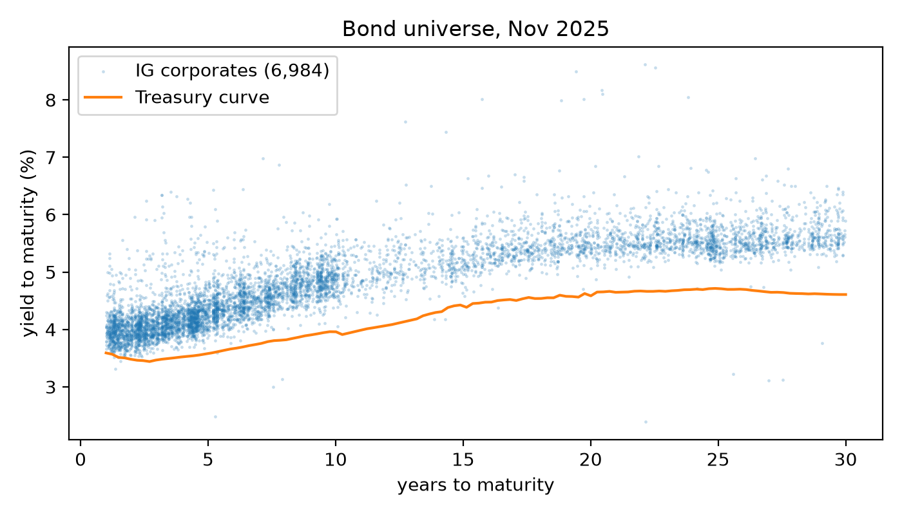
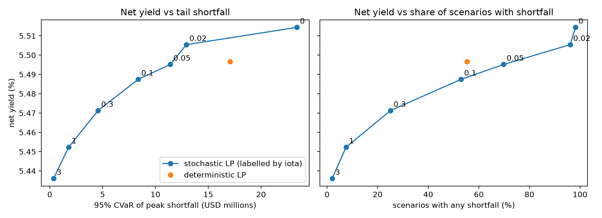

# Asset-liability matching for an annuity block

Toy study: synthetic liabilities, real bond data (WRDS snapshot, Nov 2025). A formulation exercise, not a model of any real insurer. Amounts are in USD millions unless noted.

An insurer collects a lump-sum premium from 1,000 annuitants and owes each of them 10k a year while alive. We choose a bond portfolio to cover the payments and maximize income, first with a deterministic LP on expected payouts, then with a two-stage stochastic LP over longevity and rate scenarios.

## Methodology

### Liabilities (synthetic)

- Ages uniform on 65 to 75, 10k a year each while alive, paid at year end, horizon $T = 40$.
- Gompertz mortality, $q_x = 1 - \exp\!\big(-a\,e^{bx}(e^b - 1)/b\big)$ with $a = 3.46\times10^{-5}$, $b = 0.09$ (1.25% at 65, 7.3% at 85). No lapses.
- Expected payout $L_t = 1000 \cdot P(\text{alive at } t) \cdot 10\text{k}$: 9.8 in year 1, 3.4 in year 20, 156.9 in total. Deaths are not simulated.
- PV of payouts 108.1, discounted at 3.87% (Treasury yield at the liabilities' duration). Modified duration $D_L = 8.58$.
- Assets $A = 1.02 \times \text{PV} = 110.3$. The 2% margin (about 2.2) is the cushion.

### Bonds (WRDS)

- Corporates: wrdsapps_bondret, 2025-11-30. Treasuries: CRSP daily, 2025-11-28. Nov 2025 is the latest month with a full cross-section.
- Filters: investment grade, semiannual fixed coupon, non-convertible, 1 to 30 years, not defaulted, at least 300m outstanding.
- Universe: 7,282 bonds from 800 issuers (298 Treasuries, 3,652 BBB, 2,877 A, 391 AA, 64 AAA).
- Conventions: dirty prices; annual cash flow buckets with maturity rounded to whole years; WRDS duration treated as Macaulay and converted to modified.
- Treasury curve: 1y 3.59%, 10y 3.96%, 30y 4.61%.

### Credit assumptions (synthetic)

Loss given default is 40%. Net yield is ytm minus default probability x LGD. Capital is limited by a cap, not charged for in the yield.

| rating | default prob. a year | capital factor $k$ | mean ytm | mean net yield |
| --- | --- | --- | --- | --- |
| Treasury | 0 | 0 | 3.87% | 3.87% |
| AAA | 0.01% | 0.5% | 4.51% | 4.50% |
| AA | 0.03% | 1% | 4.51% | 4.50% |
| A | 0.08% | 2% | 4.66% | 4.63% |
| BBB | 0.20% | 4% | 4.89% | 4.81% |

### Scenarios (stochastic LP)

Each scenario $\omega$ draws one longevity shock and one rate path, independently. Both are system-wide, the same for all annuitants. 200 scenarios are used inside the LP and 1,000 fresh ones to grade the result.

- **Longevity.** One multiplier $m_\omega$ on all mortality rates, lognormal, median 1, $\sigma = 0.15$. Below 1 means annuitants live longer and payouts rise. This gives the scenario payouts $L_{\omega,t}$.
- **Rates.** The cash rate is a straight line, $r_{\omega,t} = \max\!\big(r + u_\omega + v_\omega \tfrac{t-1}{T-1},\ 0\big)$, with $u_\omega, v_\omega \sim N(0, 1\%^2)$. The level shift $u_\omega$ moves the whole line up or down. The tilt $v_\omega$ is extra drift that builds to its full size by year $T$. Every path starts within about 1% of $r$ and fans out to about $\pm1.4\%$ by year 40. Rates only affect cash earnings and borrowing cost. Bond coupons are fixed and bonds are held to maturity.
- **Borrowing.** Shortfalls are borrowed at the scenario rate plus $\kappa = 3\%$.

## Optimization model

### Notation

| symbol | meaning | LP |
| --- | --- | --- |
| $x_i$ | par (face value) held in bond $i$. Chosen once, the same in every scenario | both |
| $s_t$ | cash carried from year $t$ to $t+1$. $s_0$ is what is left after buying bonds | det. |
| $s_{\omega,t}$ | cash held at the end of year $t$ in scenario $\omega$ | stoch. |
| $b_{\omega,t}$ | amount borrowed at the end of year $t$ in scenario $\omega$ to cover a shortfall | stoch. |
| $p_i$ | dirty price of bond $i$ per 1 of par | both |
| $y_i$ | net yield of bond $i$ (ytm minus default prob. x LGD) | both |
| $C_{t,i}$ | cash flow of bond $i$ in year $t$ per 1 of par (coupon plus principal) | both |
| $d_i$ | modified duration of bond $i$ | both |
| $k_i$ | capital factor of bond $i$ | both |
| $I_j$ | the bonds of issuer $j$ | both |
| $L_t$ | expected payout in year $t$ | det. |
| $A = 110.3$ | assets | both |
| $D_L = 8.58$ | modified duration of the liabilities | both |
| $r = 3.59\%$ | interest on carried cash (1y Treasury) | both |
| $\delta = 0.5$ | duration gap allowed, in years | both |
| $\bar{K} = 0.015$ | capital cap as a share of $A$ (1.65, below the 2% cushion) | both |
| $w = 0.03$ | cap per corporate issuer as a share of $A$ (Treasuries exempt) | both |
| $\omega = 1,\dots,S$ | scenario index, $S = 200$ | stoch. |
| $L_{\omega,t}$ | payout in year $t$, scenario $\omega$ | stoch. |
| $r_{\omega,t}$ | cash rate in scenario $\omega$. $r_{\omega,t-1}$ is earned on balances carried into year $t$ | stoch. |
| $\kappa = 3\%$ | borrowing spread over the cash rate | stoch. |
| $\iota$ | price of a shortfall: 1 of average borrowed balance costs $\iota$ of annual income. Larger $\iota$ gives safer, lower-yield portfolios | stoch. |

### Deterministic LP

Maximize annual income, where each bond's market value $p_i x_i$ earns its net yield $y_i$. Each year, bond cash flows plus cash carried in, minus cash carried out, must equal that year's expected payout.

$$
\begin{aligned}
\max_{x,\,s}\quad & \sum_i y_i\, p_i\, x_i \\
\text{s.t.}\quad & \sum_i p_i x_i + s_0 = A && \text{budget} \\
& \sum_i C_{t,i}\, x_i + (1+r)\, s_{t-1} - s_t = L_t, \quad t = 1,\dots,T && \text{cash matching} \\
& -\delta A \le \sum_i (d_i - D_L)\, p_i x_i \le \delta A && \text{duration} \\
& \sum_i k_i\, p_i x_i \le \bar{K} A && \text{capital} \\
& \sum_{i \in I_j} p_i x_i \le w A, \quad \forall j && \text{issuer} \\
& \sum_{i \in \text{BBB}} p_i x_i \le 0.25\, A && \text{rating} \\
& x_i \ge 0, \quad s_t \ge 0 && \text{non-negativity (no shorting)}
\end{aligned}
$$

### Stochastic LP

The portfolio $x$ is chosen once, before any scenario is known. Cash $s$ and borrowing $b$ adjust within each scenario. The objective is income minus a penalty on average borrowing.

$$
\begin{aligned}
\max_{x,\,s,\,b}\quad & \sum_i y_i\, p_i\, x_i - \frac{\iota}{S\,T} \sum_{\omega=1}^{S} \sum_{t=1}^{T} b_{\omega,t} \\
\text{s.t.}\quad & s_{\omega,0} = A - \sum_i p_i x_i, \quad \forall\, \omega && \text{budget} \\
& b_{\omega,0} = 0, \quad \forall\, \omega && \text{no initial debt} \\
& s_{\omega,t} - b_{\omega,t} = \sum_i C_{t,i}\, x_i + (1+r_{\omega,t-1})\, s_{\omega,t-1} - (1+r_{\omega,t-1}+\kappa)\, b_{\omega,t-1} - L_{\omega,t}, \quad \forall\, \omega, t && \text{cash matching} \\
& \text{duration, capital, issuer and rating limits on } x \text{ as above} && \text{portfolio limits} \\
& x \ge 0, \quad s \ge 0, \quad b \ge 0 && \text{non-negativity (no shorting)}
\end{aligned}
$$

## Results

### What was chosen

| | deterministic | stochastic, $\iota = 3$ |
| --- | --- | --- |
| bonds held | 36 | 52 |
| asset duration | 9.08 (+0.50, at the limit) | 8.86 (inside the band) |
| avg corporate duration | 10.3 | 9.7 |
| Treasuries | 12.9% | 14.4% |
| AAA | 18.9% | 15.0% |
| AA | 31.9% | 32.6% |
| A | 18.3% | 21.0% |
| BBB | 18.0% | 17.0% |
| bond cash flow, years 16 to 30 | 98 | 80 |

The capital cap binds in both. The stochastic LP shortens corporate duration and adds a long Treasury (about 9.5 years).

### Comparison

Graded on 1,000 fresh scenarios. A scenario's peak is the largest balance borrowed at any point in it (0 if none). Mean peak averages the peak over all 1,000 scenarios. 95% CVaR averages it over the worst 50. Assets are 110.3.

| portfolio | net yield | scenarios with shortfall | mean peak | 95% CVaR of peak |
| --- | --- | --- | --- | --- |
| deterministic | 5.50% | 55.4% | 3.56 | 17.08 |
| $\iota = 0$ | 5.51% | 98.2% | 13.14 | 23.39 |
| $\iota = 0.02$ | 5.51% | 96.1% | 6.14 | 12.93 |
| $\iota = 0.05$ | 5.50% | 69.8% | 2.49 | 11.41 |
| $\iota = 0.1$ | 5.49% | 53.0% | 1.40 | 8.37 |
| $\iota = 0.3$ | 5.47% | 25.1% | 0.45 | 4.57 |
| $\iota = 1$ | 5.45% | 7.5% | 0.10 | 1.79 |
| $\iota = 3$ | 5.44% | 2.0% | 0.02 | 0.36 |

Planning on expected payouts runs short in 55% of scenarios, and the worst 5% average a peak borrowing of 17.08. At $\iota = 3$ the stochastic LP cuts that to 2.0% of scenarios and a CVaR of 0.36, for about 6 bps of yield (5.50% to 5.44%). Yield falls smoothly as $\iota$ rises. At $\iota = 0$ borrowing is nearly free, so the model ignores shortfalls and does worse than the deterministic LP.

